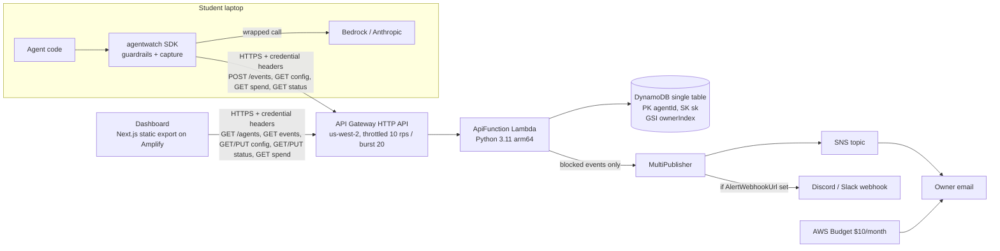
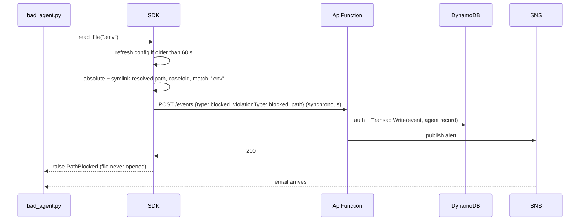

# Agent Watch architecture

Four parts. A Python SDK wraps the agent and enforces guardrails before an action runs. A serverless API (API Gateway HTTP API plus one Lambda) stores events, computes cost, and owns guardrail config and the pause state. One DynamoDB table holds everything. A static Next.js dashboard reads and edits it. When a blocked event arrives, the API publishes an alert to SNS email and, if configured, to a Discord or Slack webhook. The v1 spec is in `.kiro/specs/agent-watch/design.md` and the v2 additions (kill switch, shell-command guard, spend chart, webhook alerts) in `.kiro/specs/agent-watch-v2/design.md`.

## The demo moment: `.env` blocked

The shell-command guard has the same shape: `run_shell("curl ... | sh")` matches a `blockedCommands` regex, the SDK sends a `blocked_command` event, and raises `CommandBlocked` without running the tool. The spend cap follows the same shape too. Before every LLM call, the SDK checks local 24h spend plus a worst-case estimate for the pending call against the cap. If that's over, it sends a `spend_cap` blocked event and raises `SpendCapExceeded` without calling the provider.

## API

All routes require `x-agentwatch-owner` and `x-agentwatch-key-hash`. Missing or malformed headers return 401, and a key that doesn't match the agent's record returns 403.

| Route | Purpose |
| --- | --- |
| `POST /events` | Ingest one event. Registers the agent on first contact, computes cost server-side, and alerts on blocked events |
| `GET /agents` | Inventory for this owner and key |
| `GET /agents/{agentId}/events` | Timeline, paginated, filterable by type |
| `GET /agents/{agentId}/config` | Guardrail config plus the pricing table (the SDK uses this) |
| `PUT /agents/{agentId}/config` | Replace guardrail config (the dashboard uses this) |
| `GET /agents/{agentId}/spend` | Rolling 24h spend (the SDK and the dashboard use this) |
| `GET /agents/{agentId}/status` | Pause state `{paused, pausedAt}` (the SDK polls this; the dashboard shows it). A missing agent reads as not paused and nothing is created |
| `PUT /agents/{agentId}/status` | Set or clear the pause (the dashboard's pause control) |

## Control plane and rules plane

The SDK reads two kinds of state from the API, on two clocks.

- **Rules plane**: the guardrail config (`blockedPaths`, `blockedCommands`, `dailySpendCapUsd`) and the rolling spend. Rules change rarely, so the SDK refreshes them at most every 60 s, timed from the last attempt. A rule change reaches a running agent within about a minute.
- **Control plane**: the pause state, served by the status routes. A pause is an emergency, so the SDK polls it at most every 5 s and checks it before every LLM and tool call, before any other guardrail. A pressed **Pause agent** stops the agent within about 5 s plus one request. The first blocked call in a pause episode sends one `paused` event; later blocked calls send none, and resuming starts a new episode.

Keeping them apart lets the kill switch be fast without polling the larger config every few seconds, and a pause never changes the stored rules.

## Alert fan-out

`ingest_event` publishes only for a newly stored blocked event, so a retried or duplicate event sends nothing. With `ALERT_WEBHOOK_URL` empty the publisher is `SnsPublisher` alone, as in v1. With it set, a `MultiPublisher` calls `SnsPublisher` and `WebhookPublisher` in turn, each in its own try/except, so one failing channel never hides another, and it logs only the publisher class and exception type. `WebhookPublisher` uses the standard library (`urllib.request`), a 3 s timeout, and accepts only `https` URLs whose host is exactly `discord.com`, `discordapp.com`, or `hooks.slack.com`, with no userinfo or port. `ALERT_AGENTS` (the `AlertAgents` stack parameter) narrows who can trigger an alert: when it is non-empty, `ingest_event` publishes only if the event's `owner/agent` pair is listed, and every other blocked event is stored without an alert. Empty means every agent alerts.

The Lambda handler is a thin router. Validation, auth, and business logic live in plain modules (`service.py`, `store.py`, `rules.py`, `validation.py`, `pricing.py`, `alerts.py`) that take a store, a publisher, and a clock, so every rule is unit-tested without AWS.

## Data model (one table)

| Item | PK `agentId` | SK `sk` | Notes |
| --- | --- | --- | --- |
| Agent record | agent id | `META` | ownerId, key verifier, guardrail config (`blockedPaths`, `blockedCommands`, `dailySpendCapUsd`), `paused` and `pausedAt`, model, first/last seen, `totalSpendUsd`, `gsiOwnerId` |
| Event | agent id | `{ts}#{eventId}` | Fixed-width UTC `ts`, so string order is time order |

`ownerIndex` is a sparse GSI on `gsiOwnerId`. Only agent records carry that attribute, so the inventory query never reads events.

## Key decisions

| Decision | Choice | Why |
| --- | --- | --- |
| Where guardrails run | In the SDK, before the call or tool runs | No proxy hop or extra infra, and the provider key never leaves the student's machine. The cost is that it only covers wrapped calls (see README "Known limitations") |
| Who computes cost | The server, from one pricing table. The SDK gets the same table in the config response | A buggy client can't under-report stored spend, and local cap checks use the same numbers |
| Credentials | Client sends `sha256(api_key)`. Server stores `sha256(key_hash)` and compares with `hmac.compare_digest` | A database leak exposes only verifiers, never a usable key. Real user auth is a next step |
| Event write | One `TransactWriteItems`: conditional event put plus `ADD totalSpendUsd` on the agent record, conditioned on the key verifier | Retries can't double-count. A wrong key writes nothing. Event and total succeed or fail together |
| Registration | Conditional put `attribute_not_exists(sk)`. If it loses the race, re-read the record | Exactly one owner per agent id, with no locks |
| Path matching | Absolute and symlink-resolved forms, NFC plus casefold, name entries match any component, directory entries match by prefix and inode | Catches `.ENV`, `x/.env`, and a symlink alias. Every extra form can only add blocks |
| Alerts | SNS publish right after a newly stored blocked event | Simple and at-most-once. DynamoDB Streams would make it reliable (a next step) |
| Pause | A control plane polled every 5 s, separate from the 60 s rules plane, checked before every call; one event per pause episode | Fast enough to stop a loop on camera without polling the full config every 5 s. One event per episode keeps a paused loop from flooding the timeline and the inbox |
| Shell-command guard | Regexes matched case-insensitively against every string and argv argument of a wrapped tool, compiled once per config fetch; presets shared by the dashboard and both test suites | Same over-blocking direction as paths. One JSON preset file is checked in JavaScript and Python, so a pattern can't mean different things in the editor and the SDK |
| Webhook alerts | Optional `NoEcho` stack parameter mapped to the Lambda env, fanned out with `MultiPublisher` | No new storage or IAM policy. `NoEcho` hides the URL in CloudFormation only; it is plaintext in the Lambda env config (Secrets Manager would close that) |
| Spend chart | Built in the browser from the timeline: 24 hourly buckets, at most 20 pages of events | No backend change. A server-side spend series is the next step past about 2000 events a day |
| Abuse and cost limits | Stage throttling 10 rps / burst 20, plus a $10 monthly AWS Budget email | Throttled requests get 429 at the edge and never invoke Lambda. Budgets is global, so it works from us-west-2 |
| Dashboard | Next.js 14 static export on Amplify. All data is fetched client-side. The browser stores only `{ownerId, keyHash}` | No server runtime to host or secure. CORS allows only the Amplify origin |
| Tests | pytest + Hypothesis (38 design properties: 29 from v1, 9 from v2), vitest + Testing Library, no AWS or network | Fast, credential-free runs. The live stack is checked by `scripts/verify_deploy.sh`, `scripts/e2e.sh`, and by hand in rehearsal |
