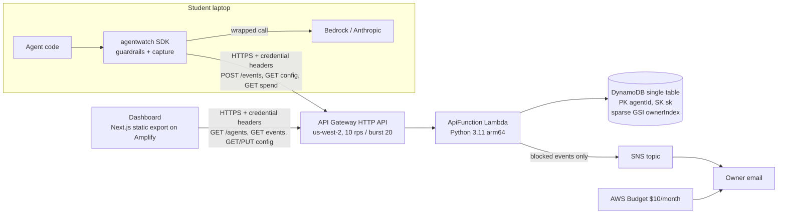

# Agent Watch: Codebase Guide

For a technical reader (a hiring manager, an interviewer, a teammate) who wants to understand what this system is, how it is built, and why it is built that way. Numbers are as of 2026-10-18: 156 commits between 2026-10-07 and 2026-10-18, 1064 tests (backend 616, SDK 317, dashboard 131), 38 property-based properties (29 from v1, 9 from v2), eight HTTP routes, one Lambda, one table. Per-task interview questions written while building live in `docs/INTERVIEW_PREP.md`; this guide is the top-down view.

Sections 1 to 9 describe the v1 core. v2 (spec in `.kiro/specs/agent-watch-v2/`) shipped a kill switch, a shell-command guard, a spend chart and summary tile, and Discord/Slack webhook alerts. Section 10 covers what shipped, the full route table, and the data model. The rate limit and the CLI (groups 12 and 13) and the optional groups 14 to 16 were cut for time and are not built.

---

## 1. The 60-second version

Students build AI agents on personal API keys. Nothing shows them what the agent called, which files it touched, or what it cost. One runaway loop can drain a month's budget; one careless tool can read `.env`.

Agent Watch is three lines of Python plus a dashboard:

```python
import agentwatch
aw = agentwatch.init(agent_id="study-bot", owner_id="tejaswi", api_key=os.environ["AGENTWATCH_KEY"])
client, TOOLS = aw.wrap(client), aw.tools(TOOLS)
```

After that, every LLM call and tool call becomes an event with its cost. The guardrails (a daily spend cap and a blocked-path list in v1; a dashboard pause button and blocked shell-command patterns in v2) are enforced **inside the SDK, before the action runs**. When one fires, the action never happens, the dashboard shows a blocked event, and an email arrives in seconds. The backend is serverless on AWS (API Gateway, Lambda, DynamoDB, SNS, Amplify), defined in one SAM template, and the whole thing was built in Kiro from a spec.

## 2. The five-minute talk track

1. **Problem and user.** First-time agent builders, no security team, no budget for mistakes. The failure modes are cost and data exposure.
2. **Design stance.** Guard a *careless* agent, not a malicious one. Enforce in the client where the action happens, because a proxy would need the student's provider key and a kernel sandbox is out of scope. Document exactly what is not covered.
3. **Shape.** Four parts: SDK, API, table, dashboard. One Lambda with a thin router; all logic in plain modules that take a store, a publisher, and a clock, so every rule is unit-tested without AWS.
4. **Three things I am proud of.**
   - The event write is one DynamoDB transaction (conditional put of the event, atomic `ADD` to the agent's total) conditioned on the key verifier. Retries cannot double count, and a wrong key writes nothing.
   - Path matching checks the absolute and the symlink-resolved form, NFC-normalized and case-folded, name entries against every component, directory entries by prefix and by inode. Every extra form can only add blocks.
   - Secrets never leave the process. The SDK sends `sha256(key)`, the server stores `sha256(sha256(key))` and compares in constant time. A database dump yields nothing usable.
5. **Verification.** 38 correctness properties from the two designs, each a Hypothesis test. A smoke script that runs all three suites, then the path block, command block, pause/resume, and spend cap against the deployed stack, and resets the demo agents in an exit trap.
6. **What v2 added.** A kill switch on a 5-second control-plane poll (about 3 s pause-to-stop live), a regex shell-command guard, a 24 h spend chart, and Discord/Slack webhook alerts fanned out next to email. Next would be a per-minute rate limit, an onboarding CLI, and real accounts.

---

## 3. High-level architecture



### Three flows to be able to narrate

**A normal LLM call.** Agent calls `client.converse(...)` on the wrapped client. The SDK refreshes config and spend if they are older than 60 s, estimates the pending cost (input chars / 4 plus the full `maxTokens` budget), checks `local_total + estimate > cap`, calls the real client, reads `usage`, computes the actual cost from the server-provided pricing table, adds it to the local total, and queues an `llm_call` event (model, tokens, metadata only, no prompt text). A daemon thread POSTs it with retries. The server recomputes the cost from its own pricing table, writes the event and the total in one transaction, and returns 200.

**A blocked tool call (the demo moment).** `tools["read_file"](".env")`. The SDK collects every path-like argument, computes two forms of each (lexical absolute, and `realpath`), folds them (NFC + casefold), matches them against each blocked entry, finds `.env` as a component, POSTs a `blocked` event **synchronously** (so a crashing agent still reports), and raises `PathBlocked`. The tool never runs. The server stores the event with cost 0, publishes to SNS, and the email arrives.

**A dashboard load.** The browser hashes the API key with Web Crypto once and stores only `{ownerId, keyHash}` in localStorage. Every request carries the two headers. The inventory page queries the sparse owner GSI (agent records only, never events) and filters by key match; it polls every 30 s. The agent page pages the timeline newest-first with cursor-based infinite scroll and lets the owner edit rules, always sending the full config.

---

## 4. Repo map

```
agent-watch/
  .kiro/
    specs/agent-watch/        v1 spec: requirements.md (26 reqs, EARS), design.md (decisions, interfaces, 29 properties), tasks.md (7 groups)
    specs/agent-watch-v2/     v2 spec: requirements 27-37, properties 30-42, task groups 8-17
    steering/                 product.md, tech.md, structure.md, workflow.md (always on); fresh-review.md (manual, #fresh-review)
    hooks/                    test-on-save (sdk/, backend/src), secrets-guard (post-save scan), session-handoff (on stop)
    settings/mcp.json         GitHub MCP server (PRs), AWS docs MCP server
  sdk/agentwatch/
    __init__.py               init, exceptions, __version__
    client.py                 Watcher, ApiClient, RequestsTransport, Sender, retries, config/spend cache, LLM proxies, tool wrapper
    guardrails.py             pure path matching (forms, fold, components, inode) and spend_decision
    pricing.py                cost math over the server's pricing table; no prices here
  sdk/tests/                  317 tests; fakes.py (FakeTransport, FakeBedrock, FakeAnthropic)
  backend/
    template.yaml             the whole AWS stack (SAM)
    src/agentwatch_api/
      handlers/api.py         Lambda entry: route table, 401 gate, 400/404/500 mapping, structured logs
      service.py              one function per route; Result(status, body); ingest pipeline; cursors; spend window
      store.py                Store protocol, InMemoryStore (tests), DynamoStore (transactions, conditions, queries)
      auth.py                 header parsing, key verifier, constant-time match
      validation.py           event schema validation, size and depth caps, NaN rejection
      rules.py                Guardrail_Config parse and serialize
      pricing.py              the single source of model prices
      alerts.py               email formatting, SnsPublisher, WebhookPublisher (v2), MultiPublisher fan-out (v2)
    tests/                    616 tests; test_properties_*.py hold Properties 1-17, 28, and v2's 31, 32, 34, 36-39
  dashboard/                  Next.js 14 App Router, static export
    app/page.tsx              inventory page (credentials form, polling, add-agent)
    app/agent/page.tsx        agent detail page (?id=, Suspense, rules editor, timeline)
    components/               CredentialsForm, InventoryTable, AddAgentForm, Timeline, RulesEditor, PauseButton, AgentSummary, SpendChart, ui/*
    lib/                      credentials.ts (SHA-256, localStorage), api.ts (typed client), types.ts, spend.ts, format.ts, commandPresets.json
  demo/
    demo_agent.py             well-behaved agent; Bedrock with Anthropic fallback; --loop N --sleep S for the cap and pause demos
    bad_agent.py              asks a question, tries read_file(".env"), then tries run_shell("curl … | sh")
    common.py, models.py      shared init/tools; the only model IDs (tested against the pricing table)
  scripts/e2e.sh              pre-recording smoke test against the deployed stack; resets both demo agents
  scripts/verify_deploy.sh    post-deploy check: GET config returns 200 with blockedCommands
  docs/                       ARCHITECTURE.md, DEMO_SCRIPT.md, SUBMISSION.md, INTERVIEW_PREP.md, this guide
  PROGRESS.md                 living state: done, next, blocked, decisions (read by every Kiro session)
  amplify.yml                 monorepo build spec (appRoot: dashboard)
```

---

## 5. Tech stack: what each piece does and why it was chosen

| Technology | Role here | Why this and not something else |
| --- | --- | --- |
| **Python 3.11** (SDK, Lambda) | Language of the SDK and the API | Students' agents are Python; the Lambda runtime matches so one pricing formula and one test style cover both sides |
| **`requests`** | The SDK's only dependency | Zero heavy deps was a requirement. `requests.Session` gives connection reuse; `allow_redirects=False` keeps credential headers from being replayed to another host |
| **`threading` + `queue`** | Background sender thread, locks around spend and config | Events are fire-and-forget so the agent is never slowed by the network; a daemon thread plus `atexit` flush is the simplest reliable shape |
| **`hashlib` + `hmac`** | SHA-256 key hashing, constant-time comparison | Standard library, no key material at rest, `compare_digest` closes timing side channels |
| **`os.path.realpath` / `os.stat` / `unicodedata`** | Path normalization, inode identity, NFC folding | Catches symlink aliases, macOS firmlinks, NFD file names, and case differences without any dependency |
| **pytest + Hypothesis** | Unit and property-based tests | The design states 29 properties; Hypothesis generates the trees, events, and failure sequences to check them. `max_examples=100`, no network |
| **AWS SAM** | Infrastructure as code, one `template.yaml` | One command deploys everything; `sam validate --lint` and a test that parses the template pin the live identity (routes, policies, no custom role) |
| **API Gateway HTTP API** | HTTPS front door, CORS, throttling | Cheaper and simpler than REST API; HTTPS-only by default; stage throttling (10 rps, burst 20) returns 429 at the edge before Lambda runs |
| **AWS Lambda (Python 3.11, arm64, 256 MB)** | Runs the whole API in one function | One cold start, one IAM role, a thin router. arm64 is cheaper. Logic is in plain modules so Lambda is just the adapter |
| **DynamoDB (single table, on-demand)** | Events and agent records | Serverless, free-tier friendly. One table keeps the event and its agent's running total in the same transaction. `PK agentId, SK ts#eventId` makes a timeline a key range |
| **DynamoDB transactions and conditions** | Idempotent writes, registration races, auth-conditioned updates | `TransactWriteItems` with `attribute_not_exists(sk)` and `keyVerifier = :kv`; `CancellationReasons` tells duplicate from forbidden |
| **DynamoDB sparse GSI (`ownerIndex`)** | Inventory per owner | Only agent records carry `gsiOwnerId`, so the index holds one item per agent and the inventory never scans events |
| **Amazon SNS (email)** | Alert delivery | One topic, one email subscription confirmed once, publish from Lambda. At-most-once by design (documented) |
| **Discord/Slack webhooks via `urllib.request`** (v2) | Second alert channel next to email | Standard library, because the Lambda runtime has no `requests`. 3 s timeout, exact-host allowlist (`discord.com`, `discordapp.com`, `hooks.slack.com`). `MultiPublisher` isolates each channel |
| **CloudFormation `NoEcho` parameter** (v2) | Carries the webhook URL into the Lambda env | Keeps the URL out of the repo, `samconfig.toml`, and `describe-stacks`. Plaintext in the Lambda env config; Secrets Manager is the next step |
| **Python `re` with `IGNORECASE`** (v2) | Blocked shell-command patterns | Compiled on the server only to validate, compiled once per config fetch in the SDK, matched only on the owner's machine. No new dependency |
| **AWS Budgets** | $10 monthly cost alarm | Budgets is global; CloudWatch billing metrics exist only in us-east-1, and the stack is in us-west-2 |
| **AWS Amplify Hosting** | Serves the static dashboard, auto-builds from `main` | No server runtime to host or secure; monorepo spec with `appRoot: dashboard`; platform `WEB` (not `WEB_COMPUTE`) because the app is a static export |
| **Next.js 14 (App Router, `output: "export"`)** | Dashboard framework | Static export avoids SSR and dynamic-route build issues; all data is fetched client-side with headers from localStorage. Detail page is `/agent?id=` so no `generateStaticParams` |
| **TypeScript** | Dashboard types mirror the backend contracts | `lib/types.ts` mirrors `InventoryItem`, `TimelineItem`, `GuardrailConfig`, `ConfigResponse`; mismatches surface at compile time |
| **Tailwind CSS + hand-authored shadcn/ui components** | Styling and primitives (Button, Input, Table, Select, Alert) | Authored directly under `components/ui/` to stay offline and avoid interactive CLIs during the build |
| **Web Crypto (`crypto.subtle.digest`)** | SHA-256 in the browser | Secure-context API; the plaintext key is hashed on submit and discarded. Same lowercase-hex output as Python's `hashlib` |
| **vitest + Testing Library + jsdom** | Dashboard tests | Fast, no browser; a small `localStorage` polyfill because this jsdom did not expose `Storage` |
| **Amazon Bedrock (Converse API) and the Anthropic SDK** | The LLMs the demo agents call | The SDK duck-types both: `converse` and `messages.create`. The demo probes Bedrock with a 1-token call and falls back to Anthropic at startup, not mid-demo |
| **boto3** | Demo only (Bedrock client) and Lambda only (DynamoDB, SNS) | Never an SDK dependency: the SDK talks only HTTPS to the API, so students' machines need no AWS credentials |
| **Kiro (specs, steering, hooks, MCP)** | The build process | Requirements-first spec with EARS acceptance criteria, a design with properties, tasks under an hour; steering keeps every session on the same stack and routine; hooks run tests on save and scan for secrets; the GitHub MCP server opened the infra PRs |
| **bash + inline Python (`scripts/e2e.sh`)** | Pre-recording smoke test | Runs the three suites, then path block, command block, pause/resume, and spend cap live; checks stored events; kills the background loop and resets agents in an `EXIT` trap. API calls go through Python so the key is hashed in-process and never on a command line |
| **Inline SVG + HTML overlay** (v2) | 24 h spend chart | No chart library. Bars stretch with `preserveAspectRatio="none"`; text lives in an `aria-hidden` HTML overlay so glyphs never distort |

---

## 6. Component deep dives

### 6.1 SDK (`sdk/agentwatch/`)

**Entry point.** `init(agent_id, owner_id, api_key, endpoint=None, *, transport, clock, sleep)` hashes the key immediately (`key_hash = sha256(utf8(api_key))`), validates the endpoint (`https://` only, `http://localhost` and `http://127.0.0.1` allowed for tests, parsed with `urlsplit` so `http://localhost.evil.com` is rejected), builds an `ApiClient`, starts the `Sender`, and does one config fetch and one spend fetch (2 s timeouts). The three injectable parameters (`transport`, `clock`, `sleep`) are how every test avoids the network and real time.

**Watcher state.** `_config: ConfigResponse` (starts as `EMPTY`: no cap, no paths, empty pricing table), `_last_config_ok`, `_last_config_attempt`, `_local_spend`, `_last_spend_attempt`, two locks. Refreshes are timed from the *last attempt*, not the last success, so an outage costs at most one request per 60 s. While no config fetch has ever succeeded the SDK logs `agentwatch: guardrails NOT active (config fetch failed)`: failing open is allowed, failing open silently is not.

**LLM proxies.** `aw.wrap(client)` returns `_BedrockProxy` (wraps `converse`) or `_AnthropicProxy` (wraps `messages.create` through a nested proxy) and raises `TypeError` for anything else, because wrapping something silently would record nothing. Every other attribute passes through via `__getattr__`. Before the call: `check_spend`. After: read `usage`, compute cost from the pricing table, add to the local total under a lock, queue an `llm_call` event with `meta = {provider, messageCount, promptChars, maxTokens, stopReason, latencyMs}`. Prompt text is never sent. Provider exceptions propagate unchanged and record no event.

**Spend check.** `estimate_pending_cost = cost(table, model, ceil(len(json(messages + system)) / 4), max_tokens)`, where `max_tokens` is the request's `max_tokens` or `inferenceConfig.maxTokens`, else 4096. Block iff `local_total + estimate > cap` (exactly reaching the cap is allowed). The estimate is deliberately worst-case, so the block can come one call early. Check and accumulate are not atomic across threads; concurrent threads can each overshoot by about one call, which is accepted rather than serializing every LLM call behind a lock.

**Tool wrapper.** `aw.tools({...})` wraps each function; `@aw.tool(name=, path_arg=)` is the decorator form. Candidates for path checking are every bound argument named `path, file_path, filepath, filename, file, src, dst, source, destination, target_path` (or `path_arg`), plus every `str`/`bytes`/`PathLike` in the positional and keyword arguments and one level inside lists and tuples. Checking every string over-blocks (`search(".env")` is blocked) and that is the safe direction. A *named* path argument whose normalization raises (a NUL byte) fails closed; any other value that fails (binary data) is skipped. The `tool_call` event carries `target` (the path, else the first argument's `repr`, 200 chars) and `meta.args` (up to 10 `repr`s, 200 chars each, trimmed to a 3 KB budget so the server's 4 KB meta cap never rejects the event). If the tool raises, the event still goes out with `meta.error = <ExceptionType>`.

**Path matching (`guardrails.py`).** Two forms per path: `Absolute_Path = normpath(abspath(expanduser(p)))` (keeps symlinks, catches a link *named* `.env`) and `Normalized_Path = realpath(expanduser(p))` (resolves symlinks, catches a link that *points into* a blocked place). Both folded with `NFC` then `casefold()`. A **Name_Entry** (no separator) matches if it equals any component of either form, so `.git` blocks `.git/config` but not `.github`. A **Directory_Entry** matches if a form equals it or starts with it plus a separator (`/a/b` blocks `/a/b/c`, not `/a/bc`), or if the entry exists and its `(st_dev, st_ino)` equals that of the path or any existing parent (macOS firmlinks, bind mounts). Adding forms only adds matches, so no form can turn a block into an allow. Not covered and documented: a hardlink under another name outside a blocked directory, and a symlink swapped between the check and the tool's own `open()` (TOCTOU).

**Sender.** A `queue.Queue` and one daemon thread. `send_with_retries` makes at most 4 attempts with sleeps of 0.5, 1, 2 s on connection errors, timeouts, 429, and 5xx; stops immediately on 2xx, 400 (log the server message), 401/403 (log `authorization failed` once per process, no retry), and other 4xx. It never raises. Blocked events bypass the queue and are sent synchronously before the exception is raised. `atexit` flushes for up to 5 s. The `Credentials` dataclass hides the hash from `repr`, and the logger never receives the key or the hash.

**Pricing (`sdk/agentwatch/pricing.py`).** No constants. `cost_from_table` is byte-for-byte the backend formula (`round((in * inPerMTok + out * outPerMTok) / 1e6, 6)`), and Property 1 asserts equality against the backend for any model and token counts. Unknown model → 0.0 and one warning per model per process, only after a real pricing table has been fetched (with `EMPTY` every model would be unknown).

### 6.2 Backend (`backend/src/agentwatch_api/`)

**Request pipeline.** `lambda_handler` looks up `event["routeKey"]` in `ROUTES` (404 otherwise), then parses the two credential headers (401 before reading the body or the path), then calls the route function, which parses the body once, and maps `BadRequest` to 400 and anything else to 500. The 500 path logs only the exception *type*, because exception messages can echo inputs or secrets. The access log is one INFO line with route, agentId (only if it validated), status, and request id. Headers are never logged. Deps (`DynamoStore`, `SnsPublisher`) are built once per container and replaced in tests.

**Auth (`auth.py`).** Headers `x-agentwatch-owner` (1 to 64 chars of `[A-Za-z0-9._-]`) and `x-agentwatch-key-hash` (exactly 64 lowercase hex). `key_verifier = sha256(key_hash)`. `matches(record, creds)` is owner equality and `hmac.compare_digest(record.key_verifier, key_verifier(creds.key_hash))`, the single call site. The received hash is never stored or logged.

**Validation (`validation.py`).** Required `agentId, ownerId, ts, eventId, type` as strings; unknown top-level fields → 400; `ts` must match the fixed-width `YYYY-MM-DDTHH:MM:SS.mmmZ` regex (with `[0-9]`, not `\d`, because `\d` also matches non-ASCII digits that would sort above `META`) and parse as a real date; `eventId` is 32 lowercase hex; `type` in `{llm_call, tool_call, blocked}`. Every field is walked iteratively (a hostile deeply nested body cannot raise `RecursionError`) to reject NaN and Infinity, and `meta` is capped at 4096 UTF-8 bytes and 32 levels. Fields that belong to another type are dropped, not rejected; then type-specific checks run (`model` and integer token counts for `llm_call`, `tool` and `target` for `tool_call`, `violationType` plus `attemptedCostUsd` or non-empty `attemptedPath` for `blocked`). `bool` is rejected wherever an int or number is expected. Any client `costUsd` is dropped; the server computes cost.

**Ingest pipeline (`service.ingest_event`).**
1. Validate (400). Body `ownerId` must equal the credentials owner (400).
2. `authorize_or_register`: read the record (consistent read); missing → conditional `PutItem` with `attribute_not_exists(sk)`; if the create loses the race, re-read and authorize again; mismatch → 403 and nothing stored.
3. Cost: 0.0 for `tool_call` and `blocked`, else `estimate_cost(model, in, out)` from `pricing.py`.
4. `store.record_event`: one `TransactWriteItems` with two items: `Put` the event conditioned on `attribute_not_exists(sk)`, and `Update` the `META` item with `ADD totalSpendUsd :c SET firstSeen = if_not_exists(firstSeen, :ts)` (plus `model = :m` for `llm_call`) conditioned on `keyVerifier = :kv`. On `TransactionCanceledException`, `classify_cancellation` reads `CancellationReasons` in item order: item 1 `ConditionalCheckFailed` → `forbidden` (auth wins even if item 0 also failed); item 0 failed and item 1 `None` → `duplicate`; anything else re-raises → 500, which the SDK retries idempotently.
5. `forbidden` → 403.
6. A duplicate's response reports the *stored* cost (one `GetItem` on that path only), not a recomputation from the resubmitted body.
7. `bump_last_seen`: `SET lastSeen = :ts` conditioned on `attribute_not_exists(lastSeen) OR lastSeen < :ts`; a failed condition is ignored, which yields "later of the two".
8. `blocked` and newly `stored` → `publish_alert` (a failure is logged, the response is still 200).
9. Return 200 `{eventId, costUsd, duplicate}`.

**Timeline (`get_timeline`).** `order` asc or desc (default asc; the dashboard uses desc), `limit` 1 to 100 (default 50), optional `type` filter, optional `cursor`. The cursor is base64url JSON `{"sk": <LastEvaluatedKey.sk>}` and is validated against the event SK regex on the way in, so a forged cursor cannot point at `META`. Because DynamoDB applies `FilterExpression` *after* `Limit`, a filtered page can be short or empty while still having a cursor; the client keeps following `nextCursor`. The key range is `sk BETWEEN "0" AND "9999999999"`, which sits below `"META"` lexicographically (digits sort before `M`), so a timeline query can never return the agent record.

**Rolling 24 h spend (`get_spend`).** Event SKs are `ts#eventId`, so a time window is an SK range. `BETWEEN` is inclusive, and the spec wants `now - 24h < ts <= now`, so both bounds get the suffix `#~` (`~` sorts after every hex digit): `start#~` as the lower bound skips every event exactly at the start, `end#~` as the upper bound keeps every event exactly at `now`. `now` is floored to milliseconds to match event precision; the sum is rounded to 6 decimals like every cost.

**Store (`store.py`).** `Store` is a `Protocol`; `InMemoryStore` mirrors the conditional semantics exactly (verifier check, then SK check, then both writes) and backs every service test; `DynamoStore` uses the low-level boto3 client with typed `AttributeValue`s (`to_av`/`from_av`), so numbers are exact `Decimal` strings (ints stay ints, costs are rounded to 6 dp by one shared `round_cost`). `list_by_owner` pages the GSI; `sum_spend` pages the key range.

**Alerts (`alerts.py`).** Subject `Agent Watch: <violationType> blocked for <agentId>` capped at 100 chars (an SNS limit). Body lines: agentId, violationType, ts, then `attemptedCostUsd` or `attemptedPath`, then `tool` and `entry` from meta, then eventId. Every value passes through `_clean`, which escapes non-printable characters so an attacker-chosen path cannot forge email lines. `publish_alert` catches everything and logs `alert_publish_failed` with the exception type only.

**Pricing (`pricing.py`).** The single source: Claude Haiku 4.5 at $1 in / $5 out per million tokens under four IDs (Bedrock base and `us.` cross-region inference profile, Anthropic dated and alias). `pricing_table()` returns the JSON the SDK receives in every config response, so prices change in exactly one file. A test imports `demo/models.py` by path and asserts both demo IDs are keys, because a typo there would silently cost 0.0 and break the cap demo.

### 6.3 Infrastructure (`backend/template.yaml`)

| Resource | What it is | Notes |
| --- | --- | --- |
| `Globals.Function` | Python 3.11, arm64, 10 s timeout, 256 MB, env `TABLE_NAME`, `TOPIC_ARN` | Logging config JSON at INFO (Lambda's root logger defaults to WARNING) |
| `Globals.HttpApi.CorsConfiguration` | `AllowOrigins: [DashboardOrigin]`, methods GET/PUT/POST/OPTIONS, the two credential headers plus `content-type` | Must live under `Globals`; an explicit `ServerlessHttpApi` resource was ignored by SAM. Duplicate origins are rejected by API Gateway, so localhost is not listed twice |
| `Globals.HttpApi.DefaultRouteSettings` | Throttling rate 10, burst 20 on the `$default` stage | Applied in place; the implicit API keeps its id and URL |
| `ApiFunction` | One function, six `HttpApi` events, two policies (`DynamoDBCrudPolicy` on the table, `SNSPublishMessagePolicy` on the topic) | No custom role; SAM's basic execution role adds only CloudWatch Logs. `test_template.py` pins exactly six routes and exactly two policies |
| `EventTable` | `PAY_PER_REQUEST`, keys `agentId` (HASH) + `sk` (RANGE), GSI `ownerIndex` on `gsiOwnerId`, projection ALL | No `TableName`, so the name is generated and the test pins that too |
| `AlertTopic` | SNS topic with one `email` subscription from the `AlertEmail` parameter | Confirmed once by the owner |
| `CostBudget` | `AWS::Budgets::Budget`, $10 monthly, ACTUAL > 100% emails `AlertEmail` | Budgets is global, so it works from us-west-2 |
| Outputs | `ApiUrl` (the SDK endpoint), `TableName`, `TopicArn` | |

Deploy facts worth knowing: stack `agent-watch` in us-west-2; `samconfig.toml` sets `confirm_changeset = true` and is never used with `--guided` (it would save the email into a public repo); redeploys pass `UsePreviousValue` for `AlertEmail` and `DashboardOrigin`; CORS allows only the Amplify origin, so local dashboard development against the deployed API needs a redeploy with `DashboardOrigin=http://localhost:3000`.

### 6.4 Dashboard (`dashboard/`)

- **Static export.** `next.config.mjs` sets `output: "export"` and `images.unoptimized`; `npm run build` writes `out/` with `/` and `/agent` prerendered. `useSearchParams` on the detail page is wrapped in `<Suspense>` because static export requires it.
- **Credentials.** `hashKey` uses `crypto.subtle.digest("SHA-256")` and formats lowercase hex, matching Python. `saveCredentials` writes only `{ownerId, keyHash}` under `agentwatch.credentials`; the form clears the key field state after hashing.
- **API client.** `apiFetch` adds the two headers, throws `AuthError` on 401/403 (which flips the page back to the credentials form) and `ApiError(message, status)` otherwise (shown inline, last data kept). `getTimeline` builds the query string with `URLSearchParams` and encodes the agent id in the path.
- **Inventory page.** Loads credentials from localStorage after mount (to avoid an SSR mismatch), polls every 30 s with `setInterval` cleared on unmount, shows `not yet reported` for agents created by a rules save before any event, and formats spend to 4 decimals with a `<$0.0001` floor so demo-sized spend never reads as `$0.00`.
- **Agent page.** `RulesEditor` loads the config and always PUTs the whole `GuardrailConfig` (the backend replaces it wholesale; an empty cap input becomes `null`); on error it shows the message and keeps the draft. `Timeline` loads desc with an `IntersectionObserver` sentinel for infinite scroll and a native `<select>` type filter that resets the list.
- **Tests.** vitest with Testing Library; fake timers for polling; `selectOptions` for the filter; a mocked `fetch`; `build.test.ts` reads the root `amplify.yml` and asserts the monorepo keys.

### 6.5 Demo agents and the smoke test

`demo_agent.py` reads `demo/notes.txt` through a wrapped `read_file` tool, asks Claude for a study tip, and with `--loop N` repeats the question until `SpendCapExceeded` stops it (exit 0, because the block is the expected outcome). `make_client` probes Bedrock with a 1-token call *through the wrapper* and falls back to the Anthropic client, so a fallback happens at startup, not mid-demo. `bad_agent.py` asks one question, announces it will "check the .env file", calls `read_file(".env")`, and exits 0 only if `PathBlocked` was raised.

`scripts/e2e.sh` runs the three suites, adds `.env` to `bad-bot` and expects `PathBlocked`, reads `demo-bot`'s rolling spend and sets the cap to spend + 0.002 so the block lands around run 3 of 5, expects `SpendCapExceeded`, checks a new `blocked_path` and `spend_cap` event exist, and resets both agents in an `EXIT` trap even on failure. The key is read only from `~/.agentwatch_key` (mode 600, outside the repo) and hashed in-process by an inline Python helper, so neither key nor hash appears in argv, output, or files. A backend test (`test_e2e_script.py`) pins those properties of the script itself.

### 6.6 Testing strategy

- **No AWS, no network, anywhere.** `InMemoryStore` and a `FakePublisher` on the backend; `FakeTransport`, a fake clock, a fake sleep, `FakeBedrock`, and `FakeAnthropic` in the SDK; a mocked `fetch` in the dashboard.
- **29 correctness properties** from the design, one Hypothesis test each with `@settings(max_examples=100)` and a tag comment (`# Feature: agent-watch, Property N: ...`). Highlights: Property 1 (SDK cost equals backend cost for any model and tokens), 9 (timeline pagination returns every event exactly once in order under any filter and page size), 10 (total spend equals the sum of distinct stored events under resubmission), 12 (registration invariants under races), 14 (authorization gate on every route), 15 (secret hygiene: verifier only on META, hash in no item, response, or log), 20 (retry policy), 24 (blocklist decision equals an independently written reference rule over generated directory trees with symlinks), 25 to 27 (metamorphic: equivalent spellings keep the decision, aliases only add blocks, case changes do not matter), 28 (transaction outcome classification).
- **Example tests** for the integration points the properties cover poorly: the 3-line snippet runs verbatim against fakes; the template parses with the right runtime, routes, policies, and budget; `DynamoStore` issues exactly the expected request shapes; the README and docs contain the required statements and no 64-hex hash.
- **Not automated by design:** latency targets, email delivery time, HTTPS-only (a platform guarantee), and constant-time comparison (a single `compare_digest` call site, checked by review). These are checked in the live rehearsal.

### 6.7 How it was built: the Kiro workflow

- **Spec first.** `requirements.md` uses EARS acceptance criteria (WHEN/IF/THE … SHALL) with a glossary of capitalized terms, so "Normalized_Path" means exactly one thing everywhere. `design.md` records decisions with reasons, interfaces, data models, 29 properties, error handling, and a testing strategy. `tasks.md` has about 60 leaf tasks under an hour each, every one test-first with its requirement references and commit message.
- **Steering.** `product.md`, `tech.md`, `structure.md`, and `workflow.md` are always on: stack, naming, "no code without a task", "handlers thin, logic in modules", "never hardcode prices outside pricing.py", "commit after every task", and the session start and handoff routine. `fresh-review.md` is manual: a new chat with no memory reviews a diff as a senior engineer and returns SHIP / FIX FIRST / REWORK.
- **Hooks.** Tests run on save for `sdk/` and `backend/src/`; a secrets guard scans every saved file for keys or prices outside `pricing.py`; a stop hook updates `PROGRESS.md` and `tasks.md`, adds interview questions, and commits the handoff.
- **MCP.** The GitHub server opened the infra PRs (#1 SAM template, #2 throttling and budget), merged only after human approval. The AWS docs server, plus the SAM translator source fetched through GitHub, verified `Globals.HttpApi` behavior before a live template change.
- **Memory across sessions.** `PROGRESS.md` holds done, in progress, next, blocked, and every decision with its reason. Each new session starts by reading it.
- **Division of labor.** Kiro wrote all project code. Claude Code reviewed diffs, verified deploys, wrote prompts and specs, and kept the state notes. The rule was that nothing in the repo is hand-written code.

---

## 7. Security model

**Threat model.** A *careless* agent: a bad prompt, a confused tool, a loop. Not a malicious one; agent code that wants to bypass the SDK can. This is stated in the README's Known limitations and is the honest answer to "can't the agent just call `open()`?".

**Identity.** No accounts. An Owner is `(ownerId, Key_Hash)`. The SDK and the browser send `sha256(api_key)`; the server stores `sha256(sha256(api_key))` (the Key_Verifier) on the agent record and nowhere else, compares with `hmac.compare_digest`, and never logs or returns either hash. The Key_Hash is a bearer credential over HTTPS; a database dump yields only verifiers, which cannot be presented as credentials.

**What protects what.**

| Risk | Control |
| --- | --- |
| Key in the database | Only the double hash is stored (Property 15) |
| Timing attack on the key check | `hmac.compare_digest`, one call site |
| Credential replay to another host | SDK never follows redirects; endpoint must be `https://` (loopback `http` for tests) |
| Someone else's events under my agent id | Event writes are conditioned on the stored verifier; a wrong key gets 403 and writes nothing |
| SDK retry double-counting spend | Conditional put on `sk` inside the transaction; duplicates return 200 without re-adding cost |
| Client lying about cost | The server recomputes cost from its own pricing table and drops client `costUsd` |
| Hostile event bodies | Unknown fields rejected; sizes, depth, NaN/Infinity, fixed-width timestamps, bools-as-ints all rejected; iterative walk prevents recursion blowups |
| Forged pagination cursor | Cursor decoded and matched against the event SK regex; the key range excludes `META` |
| Email injection via a path | Non-printable characters escaped in every alert line; subject capped |
| Secrets in logs | Handler logs only route, agent id, status, request id, and exception types; `Credentials` and `AgentRecord` hide hashes from `repr` |
| Public endpoint abuse | Stage throttling 10 rps / burst 20; $10 budget email |
| Dashboard origin | CORS allows exactly the Amplify origin |
| Over-broad IAM | Exactly two policies: CRUD on the one table, publish on the one topic |

**Known gaps, stated on purpose:** agent ids are global and first-come (the first owner and key to report an id owns it, and `GET /config` reveals whether a name is taken); alerts are at-most-once (a Lambda crash between the write and the SNS publish loses the email, never duplicates it); throttling is stage-wide, not per client; a hardlink or a swapped symlink can evade the path check; the local spend total can under-count briefly while events are still queued.

---

## 8. Key numbers

| Item | Value |
| --- | --- |
| Integration | 3 lines |
| HTTP routes | 8 (v1's 6 plus `GET`/`PUT /status`) |
| Lambda functions | 1 |
| DynamoDB tables | 1 (plus 1 sparse GSI) |
| Tests | 1064 (backend 616, SDK 317, dashboard 131), 0 failed on 2026-10-18 |
| Property-based properties | 38 (v1: 1 to 29; v2: 30 to 34 and 36 to 39) |
| SDK dependencies | 1 (`requests`) |
| Config and spend sync interval | 60 s |
| Pause poll (Control_Interval) | 5 s |
| Pause-to-stop, observed live | about 3 s (e2e 2026-10-18); 4.6 s in the 17.5 rehearsal (PUT to stored `paused` event; script limit 20 s) |
| Block-to-email, observed live | at most 1.2 s, all 4 blocks (17.5 rehearsal 2026-10-18; Gmail receive time, whole seconds) |
| Block-to-Discord, observed live | 0.2 to 1.7 s, all 4 blocks (17.5 rehearsal 2026-10-18; Discord time, whole seconds) |
| Blocked-command patterns | up to 100, each 1 to 256 chars; 9 dashboard presets |
| Webhook timeout / text cap | 3 s / 1900 chars |
| Alerts per e2e run | 4 (path, command, paused, spend cap) |
| Request timeout / retries / backoff | 2 s / 3 retries / 0.5, 1, 2 s |
| Event meta cap | 4096 bytes, depth 32 |
| Timeline page | 1 to 100, default 50 |
| Throttling | 10 rps, burst 20 |
| Budget | $10 per month |
| Lambda | Python 3.11, arm64, 256 MB, 10 s |
| Prices (Haiku 4.5) | $1 in / $5 out per million tokens |
| Commits | 156 across 2026-10-07 to 2026-10-18 |

---

## 9. Honest tradeoffs (what to say when asked what is wrong with it)

- **Client-side enforcement** covers only wrapped calls. A proxy or sandbox would cover more and cost a hop or a lot of infra. For the user (a student guarding against their own mistakes) client-side is the right first step.
- **Over-blocking by design.** Every string argument is checked against the blocklist, and matching is case-insensitive even on case-sensitive volumes. False positives are visible and cheap; false negatives are the expensive kind.
- **Worst-case cost estimate.** Using the full `max_tokens` output budget means the cap trips one call early. Predictable and safe beats precise and surprising.
- **At-most-once alerts.** Simple and never duplicates. DynamoDB Streams would make it at-least-once with dedupe; that was an optional v2 group and was not built.
- **Sequential alert fan-out (v2).** Email then webhook, each isolated, inside the ingest request. A hung webhook adds up to 3 s to that one request; async fan-out would need a queue or Streams.
- **Polling kill switch (v2).** A 5 s pull costs one small GET per interval while the agent is active and up to about 5 s of lag. It needs no inbound connection on a student laptop.
- **Regex command guard (v2).** A seatbelt, not a sandbox: obfuscated commands get past it. Patterns are not checked for catastrophic backtracking; they run only on the owner's machine against the owner's own rules.
- **No user accounts.** Two headers and a hash kept the MVP honest and testable. Real auth (Cognito) and key rotation are next steps, and agent ids being first-come is a consequence that is documented.
- **Rolling spend is a query, not a counter.** Exact and simple; at thousands of events a day per agent you would bucket by hour.
- **One pricing table in code.** Prices change in one file with a test guarding the demo IDs. A pricing API lookup would be more current and more fragile.

---

## 10. What v2 shipped (spec in `.kiro/specs/agent-watch-v2/`)

### 10.1 Features

| Feature | Mechanism | New concept to explain |
| --- | --- | --- |
| Kill switch | `paused`/`pausedAt` on the agent record, `GET`/`PUT /agents/{id}/status`, SDK polls every 5 s and checks pause first in every wrapped LLM and tool call, raises `AgentPaused`, one `paused` event per pause episode. Dashboard **Pause agent** → **Confirm pause**, one-click resume, Status column | Control plane (5 s, one small attribute, its own route) vs. rules plane (60 s, whole-config replace) |
| Shell-command guard | `blockedCommands` regexes in the config (≤100, each ≤256 chars, must compile), compiled once per fetch in the SDK, matched case-insensitively against every string and all-str argv list after whitespace collapse, checked after paths, raises `CommandBlocked`. Nine dashboard presets in `commandPresets.json`, tested in both JS and Python regex engines | Same over-blocking stance as paths; patterns compile on the server, run only on the owner's machine |
| Spend chart and tile | Client-side hourly buckets from the timeline (`llm_call` and `blocked`), inline SVG with an HTML text overlay, spend vs. cap tile with a progress bar, richer timeline rows, stale marker | No backend change; cursor following with a 20-page cap |
| Webhook alerts | `AlertWebhookUrl` (`NoEcho`) → `ALERT_WEBHOOK_URL` → `WebhookPublisher` (stdlib `urllib`, 3 s, exact-host allowlist) inside a `MultiPublisher` next to `SnsPublisher` | Fan-out isolation: a failing webhook never stops the email or fails the request |
| `**kwargs` bind fix | `_bind` lifts the VAR_KEYWORD dict to the top level (`setdefault`, real params win), so keyword-passed `command`/`path` on a `def tool(*a, **kw)` count as named | Property 33 found it; the block always happened, only the reported string and `target` were wrong |

Not built (cut 2026-10-17): the per-minute rate limit (group 12), the `agentwatch` CLI and its 0600 Key_File (group 13), and optional groups 14 to 16 (secret redaction, domain allowlist, alarms and Streams). They appear in the README only under "Not in this release".

### 10.2 Route table (all on one Lambda, all behind the credential gate)

| Route | Service function | Notes |
| --- | --- | --- |
| `POST /events` | `ingest_event` | Registers on first event; one transaction for the event and the total; publishes alerts for new `blocked` events |
| `GET /agents` | `list_inventory` | Sparse owner GSI; includes `paused` (v2) |
| `GET /agents/{agentId}/events` | `get_timeline` | asc/desc, `type` filter, `limit` 1 to 100, base64url cursor |
| `GET /agents/{agentId}/config` | `get_config` | Guardrails plus pricing table; never creates a record |
| `PUT /agents/{agentId}/config` | `put_config` | Whole-config replace; `blockedCommands` optional on input, always on output (v2) |
| `GET /agents/{agentId}/spend` | `get_spend` | Rolling 24 h sum, `now - 24h < ts <= now` |
| `GET /agents/{agentId}/status` | `get_status` (v2) | `{paused, pausedAt}`; a missing agent reads as not paused and nothing is created |
| `PUT /agents/{agentId}/status` | `put_status` (v2) | Body exactly `{"paused": bool}`; `pausedAt` is server time; never touches `guardrails` |

### 10.3 Data model (one table, PK `agentId`, SK `sk`)

| Item | SK | Attributes |
| --- | --- | --- |
| Agent_Record | `META` | `ownerId`, `gsiOwnerId` (sparse GSI key), `keyVerifier`, `guardrails` (`dailySpendCapUsd`, `blockedPaths`, `blockedCommands` (v2)), `totalSpendUsd`, `firstSeen`, `lastSeen`, `model`, `paused` and `pausedAt` (v2, written only when set; absent means not paused, so v1 items need no migration) |
| Event | `ts#eventId` | `type`, `ts`, `eventId`, `costUsd` (server-computed), plus per type: `model`/tokens (`llm_call`); `tool`/`target` (`tool_call`); `violationType` and `attemptedCostUsd`, `attemptedPath`, or `attemptedCommand` (v2) (`blocked`); `meta` (≤4 KB) |

Violation_Types accepted by the validator: `spend_cap`, `blocked_path`, `paused` (v2, meta only), `blocked_command` (v2, requires `attemptedCommand` ≤1024).

---

## 11. Interview questions and answers

Grouped by topic. Each answer is the short version; the per-task detail is in `docs/INTERVIEW_PREP.md`.

### System design

**Q: Walk me through what happens when an agent calls the model.**
A: The wrapped client refreshes config and spend if stale, estimates the pending cost, checks it against the cap, calls the real provider, reads token usage, computes cost from the server's pricing table, adds it to a local total, and queues an event. A background thread POSTs it with retries. The server validates, authorizes, recomputes cost, writes the event and the agent's total in one transaction, and returns 200. The agent never waits on the network except for the synchronous blocked-event report.

**Q: Why enforce guardrails in the SDK instead of a proxy or the backend?**
A: The action happens in the agent's process; that is the only place you can stop it before it runs without putting a proxy in front of the provider, which would need the student's provider key and add a hop to every call. The cost is coverage: only wrapped calls are guarded. That is stated in the README and matches the threat model, a careless agent rather than a malicious one.

**Q: Why one Lambda with a router instead of one function per route?**
A: One cold start, one IAM role, one deployment unit, and far fewer template lines. The handler is a thin adapter; routes are a dict lookup on `routeKey`. All logic is in plain modules that take a store, a publisher, and a clock, so the Lambda boundary is irrelevant to testing.

**Q: How do rule changes reach a running agent?**
A: The SDK caches the config and refreshes it at most once per 60 s, timed from the last attempt so an outage costs one request a minute. Failures keep the last good config and warn. Before the first success, no rules are active and the SDK says so loudly. The v2 kill switch has its own 5-second poll because a stop has a different latency budget than a rule edit.

**Q: How does the spend cap work across restarts and multiple processes?**
A: The server owns the truth: `GET /spend` sums the agent's events over the last 24 hours. The SDK seeds its local total from that at init, adds each completed call, and replaces the total with a fresh server value at most once a minute. Between syncs another process's spend is invisible, so the cap can overshoot by up to a minute of the other process's calls. That is documented.

**Q: What would you change for 1000 agents?**
A: Bucket spend per hour on the agent record instead of querying a day of events; move alerts to DynamoDB Streams for at-least-once delivery; add per-client throttling with usage plans or a WAF; replace the first-come agent-id model with real accounts; and add a server-side spend series route so the dashboard stops paging the timeline.

### AWS and serverless

**Q: Why DynamoDB single-table, and what does the key design buy you?**
A: `PK agentId, SK ts#eventId` makes a timeline a key range query in time order, and a 24-hour window an SK range. The agent record sits in the same partition under `sk = "META"`, which sorts after every event SK (digits before `M`), so one transaction can write an event and update its agent's running total together. A sparse GSI on an attribute only agent records have gives an inventory per owner that never touches events.

**Q: How do you make event ingestion idempotent?**
A: The event put is conditioned on `attribute_not_exists(sk)` and the total increment is in the same transaction, so a retried POST either writes both or neither. On a cancelled transaction I read `CancellationReasons` in item order: if the auth condition failed it is 403; if only the put failed it is a duplicate and I return 200 without re-adding cost, reporting the originally stored cost.

**Q: How do you handle two first events for the same agent arriving at once?**
A: Registration is a conditional `PutItem` with `attribute_not_exists(sk)`. Exactly one wins. The loser re-reads the record and authorizes against it like any later request. No locks, and a Hypothesis property simulates the lost race.

**Q: Why an HTTP API rather than a REST API, and where is throttling applied?**
A: Cheaper, simpler, HTTPS-only, CORS as configuration. Throttling (10 rps, burst 20) is set on the default route settings of the `$default` stage through SAM Globals, so excess requests get 429 at the edge and never invoke Lambda. It is stage-wide, not per client, which is a known limitation.

**Q: Why is the billing alarm an AWS Budget and not a CloudWatch alarm?**
A: CloudWatch billing metrics exist only in us-east-1, and the stack is in us-west-2. Budgets is a global service, so a $10 monthly budget with an email notification fits the same template.

**Q: What did you learn deploying the dashboard to Amplify?**
A: The repo-root `amplify.yml` must use the monorepo `applications:` format with `appRoot: dashboard`; the app platform must be `WEB`, not `WEB_COMPUTE`, because a static export has no server runtime; CORS config must live under `Globals.HttpApi` or SAM ignores it; and API Gateway rejects duplicate origins, so you cannot list localhost both literally and as a parameter default.

**Q: How is least privilege enforced?**
A: The function has exactly two SAM policies, `DynamoDBCrudPolicy` on the one table and `SNSPublishMessagePolicy` on the one topic, with no custom role. A template test parses the YAML and asserts exactly two policies and exactly six routes, so a drift fails CI.

### Data modeling and correctness

**Q: How do you get an exclusive lower bound from an inclusive `BETWEEN`?**
A: Event SKs are `ts#<32 hex>`. I append `#~` to both bounds; `~` sorts after every hex digit, so `start#~` is greater than every SK at the start timestamp and `end#~` is greater than every SK at the end. Lower bound exclusive, upper inclusive, exactly the `now - 24h < ts <= now` window the spec asks for.

**Q: Why fixed-width ISO timestamps with milliseconds?**
A: Lexicographic order equals time order, they are readable in the console, and they build range keys directly. Validation uses `[0-9]` rather than `\d` because `\d` matches non-ASCII digits that would sort above `META` and break the range queries.

**Q: What does `FilterExpression` after `Limit` do to your pagination?**
A: A filtered page can be short or empty and still carry a `LastEvaluatedKey`. The client keeps following the cursor until it is null. Property 9 asserts that concatenating all pages under any filter and page size yields every matching event exactly once, in order.

**Q: How do you avoid floating-point drift in costs?**
A: One `round_cost` to 6 decimals is applied everywhere a cost is written or summed, and the DynamoDB number is sent as an exact `Decimal` string. The SDK and backend share one formula, and Property 1 asserts they agree for any inputs.

### Security

**Q: Explain the key handling end to end.**
A: The plaintext key exists only in the agent's process and in the browser form for a moment. Both compute `sha256(key)` and send that as a header over HTTPS. The server computes `sha256` of that again and stores the result on the agent record, comparing with `hmac.compare_digest`. Nothing logs or returns either hash. A database read gives you verifiers, which you cannot present as credentials. The hash itself is a bearer token, which is the accepted MVP limitation.

**Q: Why hash the hash on the server instead of storing the received hash?**
A: If the stored value were the received hash, a database leak would hand out exactly the bearer value every request carries. Storing a second hash means the leaked value is useless on the wire, at the cost of one extra SHA-256 per request.

**Q: What stops a redirect from leaking credentials?**
A: `allow_redirects=False` in the transport, so a 3xx is just a non-2xx to retry or drop, and the headers are never re-sent to another host. The endpoint is also parsed with `urlsplit` and must be `https://` or loopback `http://`, so `http://localhost.evil.com` is rejected.

**Q: How does the blocklist handle symlinks and case?**
A: Two forms per path: the lexical absolute path (keeps symlinks, catches a link named `.env`) and `realpath` (resolves them, catches a link that points into a blocked directory). Both NFC-normalized and case-folded. Directory entries also match by inode, which catches macOS firmlinks and bind mounts. Every added form can only add matches. Not covered: a hardlink under a different name and a symlink swapped between check and use.

**Q: What are the known gaps and why did you leave them?**
A: Direct `open()` and shell commands outside wrapped tools, hardlinks and TOCTOU, first-come agent ids, at-most-once alerts, stage-wide throttling, brief under-counting during a spend sync. Each is either outside the threat model or a deliberate simplicity trade, and each is written down in the README so nobody assumes protection they do not have. v2 narrowed the shell-command gap with a regex guard on wrapped tools; unwrapped `subprocess` calls are still uncovered.

**Q: How do you keep secrets out of logs and errors?**
A: The handler logs route, agent id, status, request id, and exception *type* only, because messages can echo inputs. Dataclasses that hold hashes exclude them from `repr`. The SDK logger never receives the key or hash. A property test runs sequences of operations and asserts neither value appears in any item, response, or captured log record.

### Python and the SDK

**Q: How does `aw.wrap(client)` work without knowing the client class?**
A: Duck typing. If the object has a callable `converse`, it is a Bedrock runtime client and I wrap that method; if it has `messages.create`, it is an Anthropic client and I wrap through a nested proxy. Everything else passes through `__getattr__`. Anything that matches neither raises `TypeError`, because wrapping it silently would record nothing and hide the mistake.

**Q: Why is the sender a daemon thread with a queue, and how do you avoid losing events at exit?**
A: Events must never slow or crash the agent, so they are fire-and-forget through a `queue.Queue` consumed by one daemon thread that applies the retry policy. An `atexit` hook flushes the queue for up to 5 s. Blocked events are the exception: they are sent synchronously before the exception is raised, so a crashing bad agent still reports.

**Q: What is the retry policy and why those stop conditions?**
A: Four attempts with 0.5, 1, and 2 s backoff on connection errors, timeouts, 429, and 5xx. Stop on 2xx (done), 400 (a bug, retrying will not help; log the server message), 401/403 (wrong credentials; log once per process). The worst case fits the 5-second budget the requirement sets. The function never raises.

**Q: How do you test time-dependent behavior without sleeping?**
A: `init` takes an injectable monotonic clock and a sleep function. Tests advance a fake clock to trigger the 60 s refresh and record the sleeps the retry policy requests. Hypothesis generates sequences of fetch outcomes and times and checks the cache always equals the most recent success.

**Q: How do you estimate tokens before the call without a tokenizer?**
A: `ceil(len(json.dumps(messages + system)) / 4)` for input and the request's `max_tokens` (or 4096 default) for output. It is deliberately conservative: the cap trips one call early rather than one call late, and the SDK keeps zero heavy dependencies.

**Q: Is the spend check thread-safe?**
A: Reads and writes of the local total are under a lock, but check and accumulate are not one atomic step across the provider call, so concurrent threads can each overshoot by about one call. Holding the lock across the provider call would serialize every LLM call, which is worse. The overshoot is documented.

### Frontend

**Q: Why a static export and how does auth work with no server?**
A: There is nothing server-side to host or secure; Amplify serves files. The browser hashes the API key with Web Crypto, keeps only the owner id and hash in localStorage, and sends them as headers on every fetch. A 401 or 403 clears the view and shows the credentials form. CORS allows only the Amplify origin.

**Q: How does infinite scroll work and what edge case did the API force?**
A: An `IntersectionObserver` on a sentinel element loads the next page with the stored cursor. Because the backend filters after limiting, a page can be empty while still returning a cursor, so the component keeps following until the cursor is null.

**Q: Why does the rules editor send the whole config on every save?**
A: The backend replaces the config wholesale and rejects partial bodies, which keeps the server simple and makes PUT idempotent. The editor keeps a draft, sends everything, shows the returned config on success, and keeps the draft on error.

### Testing

**Q: What is a property-based test and give one from this project.**
A: A statement that must hold for all inputs, checked by generating hundreds of random cases. Property 24 generates a temporary directory tree with symlinks, a mix of blocked entries, and an attempted path, and asserts the SDK blocks exactly when an independently written reference rule says so. It found the `.ENV`, NFD, and firmlink cases that example tests would have missed.

**Q: How do you test DynamoDB behavior without DynamoDB?**
A: `InMemoryStore` mirrors the conditional semantics exactly (verifier check, SK check, both writes together), and every service property runs against it. `DynamoStore` has example tests that assert the exact request shapes and map a stubbed `TransactionCanceledException` to the right outcome for each row of the classification table. moto tests were optional and deferred.

**Q: What is deliberately not automated?**
A: Latency targets, email delivery time, HTTPS-only, and constant-time comparison. The first two are observed in the live rehearsal with a smoke script; the last two are platform guarantees and a single reviewed call site.

### Process and tooling

**Q: What did building with a spec-first tool change about how you worked?**
A: Every behavior had a numbered requirement before any code, so reviews asked "does it meet 8.13" instead of "does it look right". The design's properties became the test plan. Tasks under an hour with their own tests and commits made the history readable and made handoffs between sessions cheap because `PROGRESS.md` carried the state and every decision with its reason.

**Q: How did you keep the AI from writing the wrong thing?**
A: Steering files pinned the stack, naming, and rules like "no prices outside pricing.py" and "handlers thin"; hooks ran tests on every save and scanned for secrets; a separate fresh-eyes review in a new session with no memory reviewed each group's diff and returned SHIP / FIX FIRST / REWORK; infra changes went through PRs that a human approved. Several real fixes came from those reviews, like checking every path-like argument and failing closed on unnormalizable named paths.

**Q: What went wrong and what did you do?**
A: The original demo key lived only in a closed terminal tab and was lost; I deleted the demo data, generated a new key, and moved it to a 0600 file outside the repo that every script reads. A placeholder email in a deploy command rolled back a stack. CORS silently did nothing until it moved under SAM Globals. Each one became a note in `PROGRESS.md` and a guard in a script or test.

### v2: what shipped

**Q: Why is the pause a separate route and attribute instead of a field in the guardrail config?**
A: They are two planes with different needs. The rules plane is a whole-config replace synced every 60 s; the control plane is one boolean polled every 5 s. If `paused` lived in the config, a rules save from a stale dashboard tab could silently un-pause an agent. Separate attribute, separate route, separate poll: a rules save can never touch the pause and a pause never touches the rules.

**Q: How fast does the kill switch actually stop a running agent?**
A: About 3 s in the live e2e run on 2026-10-18, from `PUT /status` to `AgentPaused` in a `--loop 20 --sleep 2` agent. The bound is the 5 s poll plus the loop's sleep plus one in-flight call; the script fails if it takes more than 20 s.

**Q: A runaway loop calls a paused agent 100 times a second. How many alerts does the owner get?**
A: One. The first blocked call in a Pause_Episode sends a synchronous `paused` event; later calls raise locally with no network traffic. A test-and-set on a flag under the Watcher lock means two threads can't both report, and the send happens outside the lock so a slow POST never stalls other threads. A status read with `paused: false` ends the episode.

**Q: Is a regex shell-command guard real security?**
A: No, and the README says so. It's a seatbelt for a careless agent: `curl … | sh` or `rm -rf` passed straight to a wrapped tool gets blocked before a subprocess starts. Obfuscation (`$(echo cm0= | base64 -d)`) and unwrapped `subprocess` calls get past it. Real isolation would be a container or a syscall filter. Within its scope it over-blocks on purpose: every string argument is a candidate, matching is case-insensitive, and whitespace is collapsed so an extra tab can't dodge a rule.

**Q: What about ReDoS from user-supplied patterns?**
A: The server only compiles patterns to validate them (≤100 entries, ≤256 chars, must compile); it never runs them against input. Matching happens in the owner's own SDK process on the owner's own rules, so a catastrophic pattern only slows down its author. The real fix would be RE2 or a match timeout, which would add a dependency.

**Q: Your dashboard writes regexes in JavaScript and the SDK runs them in Python. How do you keep them consistent?**
A: One JSON file of presets feeds both test suites. Each pattern must compile, match its example, and miss its safe example in both `RegExp` and Python `re`, and it must pass the backend's `parse_config`. The e2e script also reads the `pipe_to_shell` pattern from that file instead of retyping it.

**Q: You added Discord alerts. How do you make sure a broken webhook never costs you the email?**
A: `MultiPublisher` calls each publisher in its own `try/except` and logs only the publisher class and exception type. SNS runs first, the webhook has a 3 s timeout, and publish failures never fail the ingest request, which still returns 200. Property 36 generates failure patterns across publishers and checks every healthy one still gets every alert.

**Q: How do you stop a webhook parameter from turning your Lambda into an SSRF primitive?**
A: The URL is parsed with `urlsplit` and must be `https`, with a host exactly `discord.com`, `discordapp.com`, or `hooks.slack.com`, and no userinfo or port. A substring check would accept `discord.com.evil.com` or `user@discord.com`. A rejected URL logs one warning without the URL and sends nothing.

**Q: What does `NoEcho` on the webhook parameter actually protect?**
A: It masks the value in `describe-stacks`, stack events, and the console, and the URL never goes in the repo or `samconfig.toml`. It does not encrypt it: the URL is plaintext in the Lambda's environment config, readable by anyone with `lambda:GetFunctionConfiguration`. Secrets Manager would close that at the cost of an extra IAM policy and a per-call read. Later deploys must pass `UsePreviousValue`, or the change set silently resets it to empty.

**Q: Tell me about a bug a property test found.**
A: Property 33 compares the wrapped tool against an independently written reference rule. Hypothesis found a `def tool(*a, **kw)` called with `command=['rm']`: the SDK reported the positional string instead of the named one. The root cause was `inspect.Signature.bind_partial().arguments`, which nests `**kwargs` under the parameter name (`{'kw': {...}}`). The tool was always blocked; only the reported string and `target` were wrong. I fixed it test-first in `_bind` by lifting those keys to the top level with `setdefault`, so a real parameter of the same name wins.

**Q: Where does the demo API key live and why that way?**
A: In `~/.agentwatch_key`, mode 0600, outside the repo. The original key once lived only in a terminal tab and was lost. Every script reads the file into an env var and hashes it in-process in Python, so neither the key nor its hash appears in argv, output, or files, and a test checks that statically. The scripts check the file is readable and non-empty, not its mode. The cut `agentwatch init` CLI would create it with `os.open(..., 0o600)` to avoid a create-then-chmod window; that's a next step.

**Q: What would you add next?**
A: The two cut v2 groups. First a per-minute LLM rate limit, a sliding window in the SDK so a tight loop gets stopped before it hits the daily cap. Then `agentwatch init`, which writes the key file with 0600 and prints the 3-line snippet. After that, the webhook URL in Secrets Manager and Streams-based at-least-once alerts.

### Behavioral and story

**Q: Why this project?**
A: I had seen classmates lose real money to agent loops and paste `.env` files into prompts. The gap was not another framework; it was visibility and a brake. Three lines and a dashboard is the smallest thing that gives both.

**Q: What are you most proud of technically?**
A: The transactional, idempotent event write conditioned on the key verifier. It makes three hard things true at once: retries cannot double count, a wrong key cannot write, and the event and the total can never disagree. And it is tested by a property, not by hoping.

**Q: What would you do with another month?**
A: Finish the cut v2 groups first: a per-minute LLM rate limit and an `agentwatch init` CLI that writes the key to a 0600 file. Then real accounts with Cognito and key rotation, Streams-based alerts, the webhook URL in Secrets Manager, a server-side spend series, and a TypeScript SDK. In that order, because each one is a demo moment or a trust moment.

---

## 12. Glossary (short)

- **Owner**: `(ownerId, Key_Hash)`; no account, no password.
- **Key_Hash**: `sha256(api_key)`, sent as a header. **Key_Verifier**: `sha256(Key_Hash)`, stored.
- **Agent_Record**: the `META` item per agent: owner, verifier, guardrails, first/last seen, model, running total (v2: `paused`, `pausedAt`).
- **Guardrail_Config**: `{dailySpendCapUsd, blockedPaths}` (v2 adds `blockedCommands`).
- **Pause_Episode** (v2): the span from the first blocked call while paused to the next status read with `paused: false`; one `paused` event per episode.
- **Command_String** (v2): a str argument, or an all-str list/tuple joined by spaces, with whitespace collapsed.
- **Config_Response**: guardrails plus the pricing table, fetched by the SDK.
- **Rolling_24h_Spend / Local_Spend_Total**: server sum over the last day / the SDK's running estimate between syncs.
- **Sync_Interval**: 60 s. **Control_Interval** (v2): 5 s for the pause state.
- **Absolute_Path / Normalized_Path**: lexical absolute (keeps symlinks) / `realpath` (resolves them). **Case_Fold**: NFC then `casefold()`.
- **Name_Entry / Directory_Entry**: a blocked entry without / with a separator.
- **Violation_Type**: `spend_cap`, `blocked_path` (v2 adds `paused`, `blocked_command`).
- **Unreported_Agent**: created by a rules save, no event yet; shows "not yet reported".
